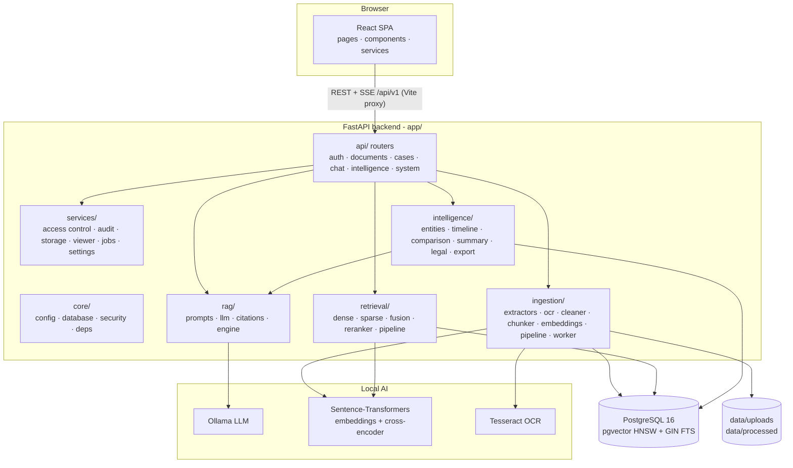
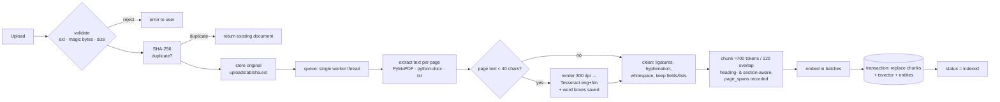
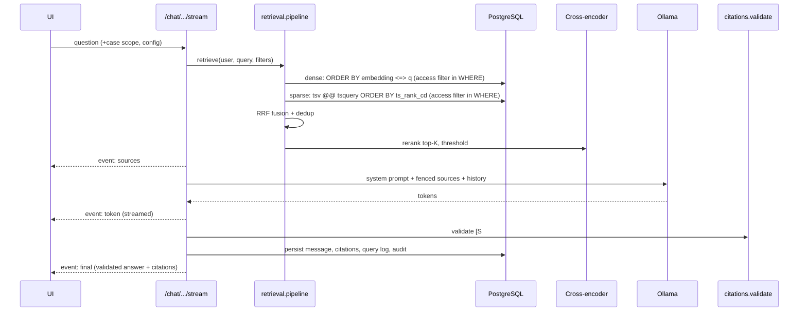

# Architecture

## Overview

BPI is a modular monolith: one FastAPI process (plus two in-process worker threads) and one PostgreSQL database. All AI components run locally. There are no microservices and no cloud dependencies.

## Layers

| Layer | Responsibility | Never does |
|---|---|---|
| `api/` | HTTP, validation (Pydantic), auth dependencies, response shaping via `services/serializers.py` | business logic, returning ORM objects |
| `services/` | access control, audit, storage, page rendering, background jobs, runtime settings | HTTP concerns |
| `ingestion/` | turn a file into cleaned, chunked, embedded, indexed rows | access control (it processes a known document) |
| `retrieval/` | permission-scoped candidate generation and ranking | generation |
| `rag/` | prompting, local LLM calls, citation validation | retrieval SQL |
| `intelligence/` | entities, timeline, comparison, summaries, legal search, exports | — |

Models are behind small interfaces (`Embedder`, `Reranker`, `OllamaClient`) so they can be swapped by configuration without code changes.

## Document ingestion

States: `uploaded → extracting → ocr → chunking → embedding → indexed | failed`. Each transition is committed, so the UI shows live progress. Re-processing deletes and re-creates a document's chunks and entities inside one transaction (idempotent). On restart, documents left mid-pipeline are marked failed with a "Reprocess" hint.

## Request flow for a question

## Access control model

- Roles: **admin** (everything), **investigator** (upload/edit documents they own or in cases they belong to), **analyst** (read & query only in cases they belong to).
- Document visibility = uploaded by the user ∪ documents of cases the user is a member of ∪ legal reference documents. Admins see all.
- The visibility predicate (`services/access.py`) is added to every document query **and to both retrieval SQL statements**, so chunks the user may not read are never scored, fused, reranked or shown to the LLM.
- Forbidden and non-existent documents both return 404 (existence is not leaked).

## Deployment

- `docker-compose.yml`: `db` (pgvector/pgvector:pg16, volume `pgdata`), `backend` (Python 3.11 + Tesseract eng/hin + CPU PyTorch; volumes for uploads and model cache), optional `ollama` and `frontend` profiles.
- Native development: backend `uvicorn` on :8000, Vite on :5173 with a proxy for `/api`.
- The app runs offline once Python/Node dependencies, the Hugging Face models and the Ollama model are present.

## Security notes

See README → Security considerations. Threats considered: unauthorized cross-case access (SQL-level filter + tests), path traversal (content-addressed storage, filename sanitization), malicious uploads (extension + magic bytes + size), XSS (React escaping, no `dangerouslySetInnerHTML`), SQL injection (SQLAlchemy parameters; FTS built from `plainto_tsquery` per token), prompt injection in documents (fenced untrusted context, instruction-pattern warnings, answers withheld if unverifiable), credential attacks (Argon2id, login throttle), sensitive logging (audit stores identifiers only).
