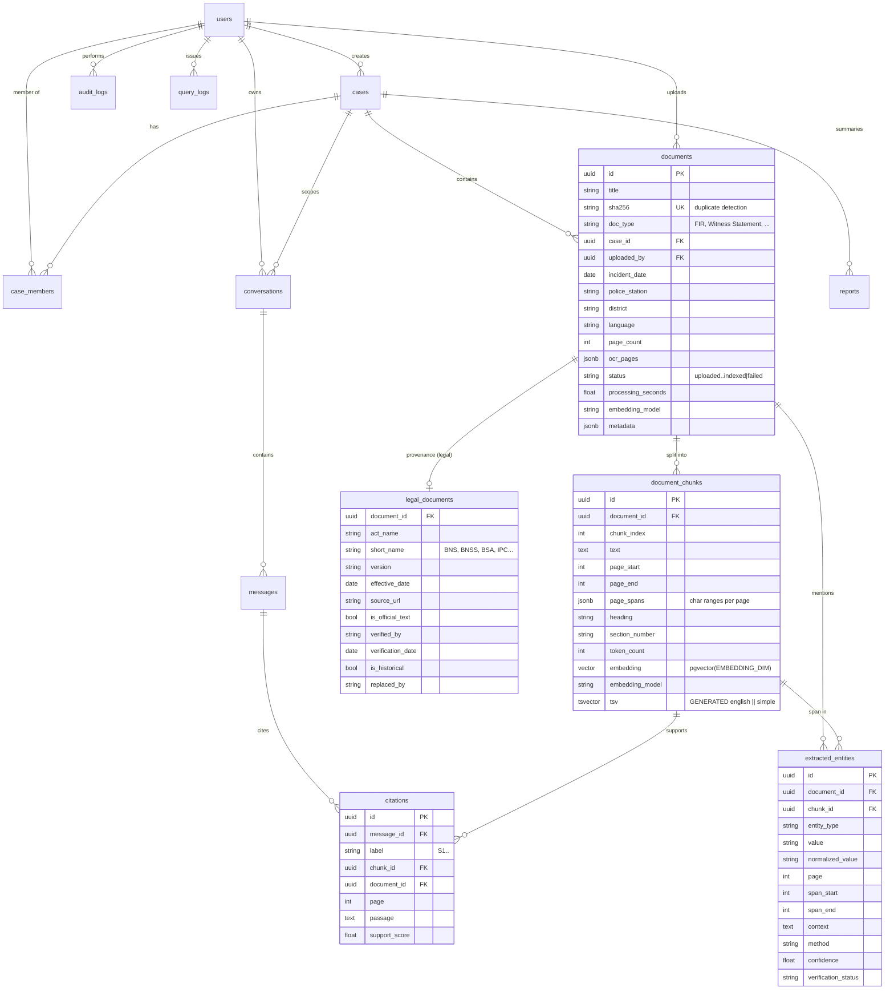

# Database design

PostgreSQL 16 with the `vector` extension. All primary keys are UUIDs; timestamps are `timestamptz`. Schema is created by Alembic (`backend/migrations/versions/0001_initial_schema.py`).

Other tables: `users` (username unique, Argon2id hash, role), `cases` (case_number unique), `case_members` (unique case+user), `conversations`, `messages` (content, abstained flag, retrieval metadata JSONB: config, sources with scores, warnings, timings), `reports` (type, JSONB content, status draft/human_verified), `query_logs` (latency and abstention for analytics), `audit_logs` (action, target, JSON detail - no document text), `app_settings` (runtime retrieval parameters).

## Indexes

| Index | Purpose |
|---|---|
| `ix_chunks_embedding_hnsw` - HNSW `vector_cosine_ops` on `document_chunks.embedding` | dense retrieval |
| `ix_chunks_tsv` - GIN on generated `tsv` | sparse retrieval |
| `documents.sha256` unique | idempotent upload / duplicates |
| `documents(case_id)`, `(doc_type)`, `(status)`, `(uploaded_by)` | access filter & listing |
| `document_chunks(document_id)`, `(embedding_model)`, `(section_number)` | scoping, model consistency, legal section lookup |
| `extracted_entities(document_id, entity_type)`, `(normalized_value)` | timeline, comparison |
| `audit_logs(created_at, action)`, `query_logs(created_at)` | dashboards |

## Integrity & lifecycle

- Deleting a document cascades to chunks, embeddings, entities and legal metadata (FK `ON DELETE CASCADE`); the API also deletes the stored file and OCR word boxes. Citations keep their text but lose the chunk link (`SET NULL`), preserving conversation history.
- Deleting a case keeps its documents (they become unassigned) - documents are never silently destroyed.
- Each chunk records the `embedding_model` that produced it; retrieval only compares vectors from the active model. Changing dimension → `python -m app.cli reindex --recreate`.
